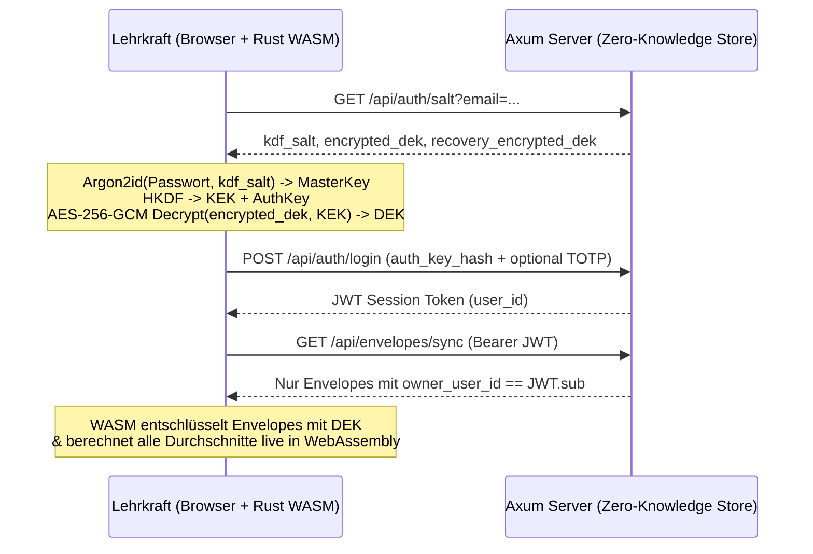

# Architektur- & Review-Handbuch (`v1.1.2`)

Dieses Dokument richtet sich an Entwicklerinnen, Entwickler, Datenschutzbeauftragte und Fachlehrkräfte, die die Version `1.1.2` von **Gradus21** begutachten, testen und weiterentwickeln.

---

## 1. Systemüberblick & Sicherheitsversprechen

**Gradus21** trennt strikt zwischen:
1. **Klartext-Domänenlogik im Browser (`crates/gradus21-core` als WebAssembly + `web/`)**:
   - Alle Namen, Einzelnoten, Bemerkungen, Gewichtungen und Niveaustufen (`G`/`M`/`E`) existieren im Klartext **ausschließlich im flüchtigen Arbeitsspeicher des Browsers**.
2. **Blinder Synchronisations- & Authentifizierungs-Server (`crates/gradus21-server`)**:
   - Speichert pro Lehrkraft (`owner_user_id`) lediglich kryptografische Metadaten (`kdf_salt`, `encrypted_dek`, `recovery_encrypted_dek`, Passkey-/TOTP-Daten) sowie undurchsichtige `AES-256-GCM`-Envelopes (`encrypted_payload`).
   - Der Server besitzt zu keinem Zeitpunkt Kenntnis über Passwörter, Entschlüsselungsschlüssel (`DEK`), Klassenstrukturen oder Schüler:innennamen.

---

## 2. Kryptografische Spezifikation (`crates/gradus21-core/src/crypto.rs`)

| Komponente | Verfahren / Parameter | Zweck |
| :--- | :--- | :--- |
| **Passwort-KDF** | `Argon2id` (`m = 19456 KiB` / 19 MiB, `t = 2`, `p = 1`, Output `32 Byte`, OWASP Minimum) | Schutz gegen GPU-/ASIC-Cracking bei hypothetischer Kompromittierung der Server-Datenbank |
| **Key Separation** | `HKDF-SHA256` mit Domänen-Labels `BTE-NotenFlow-v2-KEK` & `BTE-NotenFlow-v2-AuthKey` | Trennt den lokalen *Key Encryption Key (KEK)* strikt vom Server-Login-Hash *(Hinweis: Bezeichner aus Protokoll-v2-Abwärtskompatibilität)* |
| **Payload-Chiffre** | `AES-256-GCM` (`96-Bit` Zufalls-Nonce pro Schreibvorgang) | Authentifizierte Verschlüsselung (Confidentiality + Authenticity) |
| **Context Binding (AAD)** | `AAD = "owner:{owner_user_id}\|entity:{entity_id}"` | Verhindert kryptografisch das Vertauschen oder Einschleusen von Chiffretexten zwischen Benutzer:innen oder Datensätzen |
| **Notfall-Schlüssel** | `24-stelliger Base32-Code` -> `HKDF-SHA256` (`BTE-NotenFlow-v2-RecoveryKEK` & `BTE-NotenFlow-v2-RecoveryAuthKey`) | Erlaubt kryptografisch verifizierten Passwort-Reset ohne Verlust des `DEK` (`wasm_wrap_dek_with_recovery` / `wasm_recover_dek`) |
| **Passkey PRF Hardware-Schutz** | WebAuthn `hmac-secret` / `prf` Extension -> `HKDF-SHA256` (`BTE-NotenFlow-v2-PasskeyKEK`) | Direkte Entschlüsselung des `DEK` über Hardware-Security-Keys (TouchID, Windows Hello, YubiKey) |

---

## 3. Pädagogische Berechnungs-Engine (`crates/gradus21-core/src/grading.rs`)

### 3.1 Proportionale Kategorien-Skalierung (`scale_empty_categories`)
In vielen Klassen existieren zu Schuljahresbeginn z. B. bereits Vokabeltests (*Kategorie Tests: 20%*), aber noch keine Klassenarbeit (*Kategorie LNW: 50%*) und noch keine mündliche Note (*30%*).
- Ist `scale_empty_categories = true` (Standard), werden nur Kategorien mit mindestens einer bewerteten Leistung herangezogen und deren Gewichte proportional auf `100 %` normiert.
- Fehlt eine Schüler:in entschuldigt (`status = "excused"` / Eingabe `K` / Attest), wird diese Prüfung für dieses Kind neutral übersprungen, ohne den Teiler zu verfälschen.

### 3.2 Streichnoten (`drop_lowest_count`)
- Jede Kategorie kann `drop_lowest_count` (`0`, `1` oder `2`) definieren.
- Wichtig: Es wird immer mindestens **eine** Note pro Kategorie behalten (`let drop = cat.drop_lowest_count.min(scores.len().saturating_sub(1))`), damit eine Kategorie mit nur einer geschriebenen Arbeit niemals leerläuft.

### 3.3 Notenschlüssel & Binnendifferenzierung (`G` / `M` / `E`)
Die Umrechnung von Prozent (`0.0..=100.0`) in eine Note erfolgt in `percent_to_grade`:
1. Zunächst wird geprüft, ob für die Klasse `enable_student_levels = true` aktiviert ist.
2. Falls ja, wird der konfigurierte Prozent-Offset der Niveaustufe (`level_threshold_offsets`, z. B. `G: -5.0`, `M: 0.0`, `E: +3.0`) angewendet:
   $$\text{adjusted\_percent} = \text{clamp}(\text{percent} - \text{offset}, 0, 100)$$
   - Ein **negativer Offset** (z. B. `-5 %` auf `G`-Niveau) bedeutet: Die benötigte Prozenthürde sinkt um 5 Prozentpunkte (wer `70 %` erreicht, wird auf `70 - (-5) = 75 %` angehoben und erreicht bei einer 75%-Schwelle bereits die **Note 2**).
   - Ein **positiver Offset** (z. B. `+3 %` auf `E`-Niveau) bedeutet: Die benötigte Prozenthürde steigt um 3 Prozentpunkte (für eine **Note 2** sind `78 %` statt `75 %` erforderlich).

### 3.4 Zielnoten- & "Was-wäre-wenn"-Simulator (v2)
- Erlaubt in Eltern- und Beratungsgesprächen die mathematisch exakte Rückrechnung: *"Welche Prozentzahl bzw. Punktzahl benötigt die Schülerin in der nächsten Arbeit, um eine Zielnote zu erreichen oder zu sichern?"*
- Unterstützt alle 3 Berechnungsmodi (*Kategorien-Töpfe*, *Direkte Faktoren*, *Punktesammler*).

---

## 4. Schulweite Administration & Enterprise-Infrastruktur (`crates/gradus21-server/src/admin.rs`)

### 4.1 Rollenbasierte Benutzerverwaltung (RBAC)
- Administratoren (`is_admin: true`) können neue Kolleg:innen per E-Mail einladen oder temporär sperren.
- **Sicherheits-Invarianten**:
  - Zero-Knowledge bleibt strikt gewahrt: Administrator:innen können weder Noten noch Klassennamen von Kolleg:innen einsehen.
  - Der letzte Administrator eines Systems kann weder gelöscht noch degradiert werden (Schutz vor administrativem Ausschluss).

### 4.2 Globale Notenvorlagen & Schulspezifische Standards
- Vordefinierte Vorlagen (*Gymnasium G9*, *Realschule 50/50*, *Gemeinschaftsschule G/M/E*, *MSS Oberstufe*) werden beim Serverstart automatisch initialisiert.
- Fachschaften können schulweite Vorlagen anlegen, bearbeiten oder individuelle Ableitungen erstellen.

### 4.3 Snapshot-Backups mit automatischer Retention
- Atomare Datensicherungen im JSON- und PostgreSQL-Format.
- Zeitgesteuerter Hintergrund-Scheduler für wiederkehrende Snapshots mit konfigurierbarer Aufbewahrungsdauer (z. B. 30 Tage Retention).

---

## 5. Lokaler Speicher, Cloud-Sync Opt-In & Backup-Architektur

### 5.1 Striktes Opt-In & Datensparsamkeit (DSGVO / bDSB Standard)
Gradus21 setzt das Prinzip der **Datensparsamkeit (Art. 5 Abs. 1 lit. c DSGVO)** architektonisch durch:
1. **Standardmäßig lokale Persistenz**:
   - Für jede Lehrkraft existiert standardmäßig `cloudSyncEnabled: false`.
   - Klassen, Noten und Benutzereinstellungen werden mit Argon2id + AES-256-GCM verschlüsselt und ausschließlich in `localStorage` (`gradus21_e2ee_user_vault_v3_<userId>`) sowie im angebundenen Schullaufwerk gespeichert.
   - Der Client sendet im Standardbetrieb **keine Requests** an `/api/envelopes` oder `/api/preferences`.
2. **Opt-In Aktivierung**:
   - Erst nach expliziter Aktivierung im Anmeldedialog oder unter *Einstellungen -> Datenschutz & Speicher* werden `AES-256-GCM` Envelopes mit dem Server synchronisiert.
3. **Restlose Server-Löschung (`DELETE /api/envelopes`)**:
   - Ein 1-Klick-Befehl löscht alle serverseitig gespeicherten Umschläge der Lehrkraft unwiderruflich aus der Datenbank (unter strikter Tenant-Isolation). Der lokale Bestand bleibt voll erhalten.

### 5.2 Automatisierte Sicherung auf Schullaufwerke (File System Access API)
- Die moderne **File System Access API** (`showDirectoryPicker()`) ermöglicht der Lehrkraft, einen beliebigen Ordner auf dem Rechner oder ein gemountetes SMB/NFS-Schulnetzlaufwerk auszuwählen.
- Der Berechtigungshandle (`FileSystemDirectoryHandle`) wird in der IndexedDB-Datenbank `gradus21_local_backup_v1` persistent hinterlegt.
- Bei jeder automatischen Speicherung erzeugt der Hook `useVaultWorkspaceSync` eine signierte Backup-Datei:
  `gradus21_vault_backup_<userId>.gradus21`
  inklusive Zeitstempel, SHA-256-Prüfsumme und verschlüsselten Envelopes.

### 5.3 Persistenter Browser-Speicher (`navigator.storage.persist()`)
- Um zu verhindern, dass Webkit-/Blink-Engines bei Speicherknappheit oder Browser-Updates den IndexedDB- oder LocalStorage-Bestand bereinigen, fordert die App beim Start automatisch `navigator.storage.persist()` an.
- Der aktuelle Status (`Persistenter Schutz aktiv` vs. `Standard`) wird in den Einstellungen transparent visualisiert.

### 5.4 100 % Offline-Fähigkeit & Service Worker (PWA)
- **Service Worker (`web/public/sw.js`)**:
  - Pre-cached die App Shell (`/index.html`, `/favicon.svg`, `/fonts/fonts.css`, Web App Manifest).
  - Nutzt Stale-While-Revalidate für JS, CSS, SVG und die compilierte `gradus21_core_bg.wasm`.
  - API-Calls unter `/api/*` bleiben network-only.
- **Lokale Notfall- & Offline-Entsperrung**:
  - Befindet sich das Gerät im Flugmodus oder ist das Schul-WLAN gestört, fällt der Login-Dialog automatisch auf die lokale Schlüsselableitung zurück:
    Argon2id berechnet den Master Key im WebAssembly-Modul und entschlüsselt den lokal gespeicherten DEK.
  - Auch hinterlegte Passkeys (Touch ID, Windows Hello, Face ID) können offline entsperrt werden, da der passkey-gewrappte DEK im lokalen Gerätespeicher vorgehalten wird.

### 5.5 Multi-Device Real-Time Synchronisation & Silent Auto-Renewal
- **Reconciliation & Zero-Loss Sync**:
  - Klassenbezogene 3-Wege-Zusammenführung (`mergeClassroomDatasets`) verhindert Datenverluste, falls auf unterschiedlichen Endgeräten parallel Noten erfasst wurden.
  - Echte Kollisionen lösen die Erstellung einer lokalen Sicherheitskopie (`<Klasse> (Lokale Noten-Kopie)`) aus.
- **Hintergrund-Synchronisation**:
  - Ereignisbasiertes Nachladen bei Tab-Aktivierung (`visibilitychange` und `focus`) sowie ein schonendes 12-Sekunden-Polling bei aktivem Browser-Fenster halten den Notenstand geräteübergreifend synchron.
- **Stille Sitzungserneuerung**:
  - Läuft ein JWT-Sitzungstoken nach Inaktivität ab (HTTP 401), erneuert der Client die Sitzung transparent im Hintergrund über den aus dem Master Key abgeleiteten `AuthKey`, ohne den Lehrenden durch Anmeldedialoge aus dem Arbeitsfluss zu reißen.

---

## 6. Checkliste für das Audit & Review (`v1.1.2`)

### A. Fachlich-Pädagogisches Review
- [x] **Rundungsregeln je Bundesland / Schulordnung**: Exakte Weiterberechnung via IEEE-754 `f64`, Rundung bei der Anzeige auf `0.1 %` bzw. `0.01` Notenwert.
- [x] **Binnendifferenzierung (`G`/`M`/`E`)**: Proportionale Niveaustufen-Verschiebung mit Live-Vergleichstabelle.
- [x] **Halbjahres-Verrechnung (`Gesamtjahr`)**: Umschaltbare Halbjahres-Filter und gemeinsame Kategorien-Verrechnung.

### B. Security- & Datenschutz-Review
- [x] **PostgreSQL-Persistenz & Atomares Backup**: `DATABASE_URL` PostgreSQL-Anbindung und transaktionales JSON-Write-and-Rename.
- [x] **Granulare E2EE-Envelopes & OCC**: Klassen-Granularität und Versionsprüfung mit `409 Conflict`-Handling.
- [x] **Cloud-Sync Opt-In & Server-Purge**: Standardmäßig rein lokaler Betrieb, Server-Datenlöschung via `DELETE /api/envelopes`.
- [x] **Art. 17 DSGVO Account-Selbstlöschung**: Vollständige Server-Löschung aller Benutzerdaten via `DELETE /api/users/me`.
- [x] **E-Mail-Verifikationsschutz**: Kryptografischer Constant-Time-Vergleich und Brute-Force Rate Limiting.
- [x] **Multi-Device Real-Time Sync & Stille Erneuerung**: Tab-Focus-Sync und transparente 401-Re-Auth ohne Klartext-Passwortspeicherung.
- [x] **Lokale Schullaufwerk-Spiegelung**: File System Access API & IndexedDB Handle Persistence.
- [x] **PWA & Offline-Resilienz**: Service Worker Caching und vollständig netzwerkunabhängige Entsperrung.
- [x] **Passkey PRF Hardware-Verschlüsselung**: W3C WebAuthn Level 3 PRF Extension und lokaler Fallback.
- [x] **Multi-Tenancy & Rate Limiting**: Strikte Mandantentrennung und Brute-Force-Schutz auf `/api/auth/*`.
