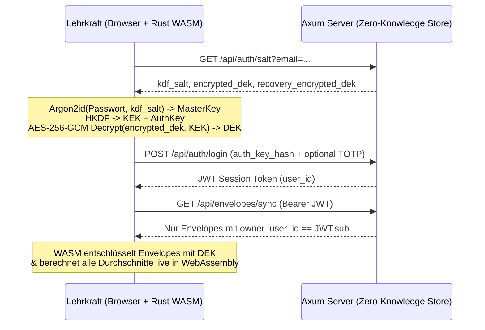

# Architektur- & Review-Handbuch (`v0.1.0-alpha`)

Dieses Dokument richtet sich an Entwicklerinnen, Entwickler, Datenschutzbeauftragte und Fachlehrkräfte, die die Alpha-Version `0.1.0` von **Gradus21** begutachten, testen und für zukünftige Releases weiterentwickeln.

---

## 1. Systemüberblick & Sicherheitsversprechen

**Gradus21** trennt strikt zwischen:
1. **Klartext-Domänenlogik im Browser (`crates/gradus21-core` als WebAssembly + `web/`)**:
   - Alle Namen, Einzelnoten, Bemerkungen, Gewichtungen und Niveaustufen (`G`/`M`/`E`) existieren im Klartext **ausschließlich im flüchtigen Arbeitsspeicher des Browsers**.
2. **Blinder Synchronisations- & Authentifizierungs-Server (`crates/gradus21-server`)**:
   - Speichert pro Lehrkraft (`owner_user_id`) lediglich kryptografische Metadaten (`kdf_salt`, `encrypted_dek`, `recovery_encrypted_dek`, Passkey-/TOTP-Daten) sowie undurchsichtige `AES-256-GCM`-Envelopes (`encrypted_payload`).
   - Der Server besitzt zu keinem Zeitpunkt Kenntnis über Passwörter, Entschlüsselungsschlüssel (`DEK`), Klassenstrukturen oder Schüler:innennamen.

---

## 2. Kryptografische Spezifikation (`crates/gradus21-core/src/crypto.rs`)

| Komponente | Verfahren / Parameter | Zweck |
| :--- | :--- | :--- |
| **Passwort-KDF** | `Argon2id` (`m = 19456 KiB` / 19 MiB, `t = 2`, `p = 1`, Output `32 Byte`, OWASP Minimum) | Schutz gegen GPU-/ASIC-Cracking bei hypothetischer Kompromittierung der Server-Datenbank |
| **Key Separation** | `HKDF-SHA256` mit Domänen-Labels `BTE-NotenFlow-v2-KEK` & `BTE-NotenFlow-v2-AuthKey` | Trennt den lokalen *Key Encryption Key (KEK)* strikt vom Server-Login-Hash *(Hinweis: Bezeichner aus Protokoll-v2-Abwärtskompatibilität)* |
| **Payload-Chiffre** | `AES-256-GCM` (`96-Bit` Zufalls-Nonce pro Schreibvorgang) | Authentifizierte Verschlüsselung (Confidentiality + Authenticity) |
| **Context Binding (AAD)** | `AAD = "owner:{owner_user_id}\|entity:{entity_id}"` | Verhindert kryptografisch das Vertauschen oder Einschleusen von Chiffretexten zwischen Benutzer:innen oder Datensätzen |
| **Notfall-Schlüssel** | `24-stelliger Base32-Code` -> `HKDF-SHA256` (`BTE-NotenFlow-v2-RecoveryKEK` & `BTE-NotenFlow-v2-RecoveryAuthKey`) | Erlaubt kryptografisch verifizierten Passwort-Reset ohne Verlust des `DEK` (`wasm_wrap_dek_with_recovery` / `wasm_recover_dek`) |
| **Passkey PRF Hardware-Schutz** | WebAuthn `hmac-secret` / `prf` Extension -> `HKDF-SHA256` (`BTE-NotenFlow-v2-PasskeyKEK`) | Direkte Entschlüsselung des `DEK` über Hardware-Security-Keys (TouchID, Windows Hello, YubiKey) |

---

## 3. Pädagogische Berechnungs-Engine (`crates/gradus21-core/src/grading.rs`)

### 3.1 Proportionale Kategorien-Skalierung (`scale_empty_categories`)
In vielen Klassen existieren zu Schuljahresbeginn z. B. bereits Vokabeltests (*Kategorie Tests: 20%*), aber noch keine Klassenarbeit (*Kategorie LNW: 50%*) und noch keine mündliche Note (*30%*).
- Ist `scale_empty_categories = true` (Standard), werden nur Kategorien mit mindestens einer bewerteten Leistung herangezogen und deren Gewichte proportional auf `100 %` normiert.
- Fehlt eine Schüler:in entschuldigt (`status = "excused"` / Eingabe `K` / Attest), wird diese Prüfung für dieses Kind neutral übersprungen, ohne den Teiler zu verfälschen.

### 3.2 Streichnoten (`drop_lowest_count`)
- Jede Kategorie kann `drop_lowest_count` (`0`, `1` oder `2`) definieren.
- Wichtig: Es wird immer mindestens **eine** Note pro Kategorie behalten (`let drop = cat.drop_lowest_count.min(scores.len().saturating_sub(1))`), damit eine Kategorie mit nur einer geschriebenen Arbeit niemals leerläuft.

### 3.3 Notenschlüssel & Binnendifferenzierung (`G` / `M` / `E`)
Die Umrechnung von Prozent (`0.0..=100.0`) in eine Note erfolgt in `percent_to_grade`:
1. Zunächst wird geprüft, ob für die Klasse `enable_student_levels = true` aktiviert ist.
2. Falls ja, wird der konfigurierte Prozent-Offset der Niveaustufe (`level_threshold_offsets`, z. B. `G: -5.0`, `M: 0.0`, `E: +3.0`) angewendet:
   $$\text{adjusted\_percent} = \text{clamp}(\text{percent} - \text{offset}, 0, 100)$$
   - Ein **negativer Offset** (z. B. `-5 %` auf `G`-Niveau) bedeutet: Die benötigte Prozenthürde sinkt um 5 Prozentpunkte (wer `70 %` erreicht, wird auf `70 - (-5) = 75 %` angehoben und erreicht bei einer 75%-Schwelle bereits die **Note 2**).
   - Ein **positiver Offset** (z. B. `+3 %` auf `E`-Niveau) bedeutet: Die benötigte Prozenthürde steigt um 3 Prozentpunkte (für eine **Note 2** sind `78 %` statt `75 %` erforderlich).

### 3.4 Zielnoten- & "Was-wäre-wenn"-Simulator (v2)
- Erlaubt in Eltern- und Beratungsgesprächen die mathematisch exakte Rückrechnung: *"Welche Prozentzahl bzw. Punktzahl benötigt die Schülerin in der nächsten Arbeit, um eine Zielnote zu erreichen oder zu sichern?"*
- Unterstützt alle 3 Berechnungsmodi (*Kategorien-Töpfe*, *Direkte Faktoren*, *Punktesammler*).

---

## 4. Schulweite Administration & Enterprise-Infrastruktur (`crates/gradus21-server/src/admin.rs`)

### 4.1 Rollenbasierte Benutzerverwaltung (RBAC)
- Administratoren (`is_admin: true`) können neue Kolleg:innen per E-Mail einladen oder temporär sperren.
- **Sicherheits-Invarianten**:
  - Zero-Knowledge bleibt strikt gewahrt: Administrator:innen können weder Noten noch Klassennamen von Kolleg:innen einsehen.
  - Der letzte Administrator eines Systems kann weder gelöscht noch degradiert werden (Schutz vor administrativem Ausschluss).

### 4.2 Globale Notenvorlagen & Schulspezifische Standards
- Vordefinierte Vorlagen (*Gymnasium G9*, *Realschule 50/50*, *Gemeinschaftsschule G/M/E*, *MSS Oberstufe*) werden beim Serverstart automatisch initialisiert.
- Fachschaften können schulweite Vorlagen anlegen, bearbeiten oder individuelle Ableitungen erstellen.

### 4.3 Snapshot-Backups mit automatischer Retention
- Atomare Datensicherungen im JSON- und PostgreSQL-Format.
- Zeitgesteuerter Hintergrund-Scheduler für wiederkehrende Snapshots mit konfigurierbarer Aufbewahrungsdauer (z. B. 30 Tage Retention).

---

## 5. Checkliste für das Alpha-Review (`v0.1.0` -> `v0.2.0`)

### A. Fachlich-Pädagogisches Review
- [ ] **Rundungsregeln je Bundesland / Schulordnung**: Soll der Kategorie-Durchschnitt vor der Gesamtgewichtung auf eine Nachkommastelle gerundet oder exakt (IEEE-754 `f64`) weitergerechnet werden? (Aktuell: exakte Weiterberechnung, Rundung bei der Anzeige auf `0.1 %` bzw. `0.01` Notenwert).
- [ ] **Binnendifferenzierung (`G`/`M`/`E`)**: Sollen neben einer linearen Prozent-Verschiebung (`level_threshold_offsets`) künftig auch komplett getrennte Notenschlüssel-Tabellen pro Niveau hinterlegt werden können?
- [ ] **Halbjahres-Verrechnung (`Gesamtjahr`)**: Sollen im Modus `Gesamtjahr (all)` das 1. und 2. Halbjahr je `50:50` gewichtet werden oder alle Leistungsnachweise des gesamten Schuljahres gemeinsam in ihre Kategorien fließen? (Aktuell: gemeinsame Kategorien-Verrechnung über alle Assessments).

### B. Security- & Backend-Review
- [x] **PostgreSQL-Persistenz & Atomares Backup**: Sobald `DATABASE_URL` gesetzt ist, synchronisiert `gradus21-server` alle Benutzer:innen und E2EE-Envelopes direkt in PostgreSQL (`users` & `encrypted_envelopes`) und nutzt für den lokalen JSON-Store atomares Write-and-Rename (`.json.tmp`).
- [x] **Granulare E2EE-Envelopes pro Entität & Optimistic Concurrency Control (OCC)**: Jede Klasse (`ClassroomSubjectDataset`) wird in ihrem eigenen `AES-256-GCM`-Envelope (`entity_type = 'class_dataset'`) mit AAD-Bindung persistiert. `BatchUpsertItem` validiert `expected_version` und antwortet bei Versionskonflikten mit `409 Conflict` samt dem aktuellen Server-Envelope zur automatischen, verlustfreien Zusammenführung.
- [x] **Passkey PRF Hardware-Verschlüsselung**: Vollständig implementiert via WebAuthn `prf` / `hmac-secret` Extension und kryptografischem KEK-Wrapping (`wrap_dek_with_passkey_prf` / `unwrap_dek_with_passkey_prf`).
- [ ] **WebAuthn Attestation-Signaturprüfung**: In `v0.1.0-alpha` validiert der Server die Passkey-Credential-ID. Vor `v1.0` soll `webauthn-rs` für die kryptografische Signaturprüfung des Authenticator-Attestation-/Assertion-Objekts auf dem Server integriert werden.
- [x] **Rate Limiting & Payload-Limits**: Auf `/api/auth/*` ist ein Sliding-Window Rate-Limiting aktiv; Request-Payloads sind auf `10 MiB` begrenzt.
- [x] **Admin-Rechte-Absicherung**: Letzter Administrator kann nicht entfernt werden; Endpunkte `/api/admin/*` erfordern gültige `is_admin`-JWT-Claims.
