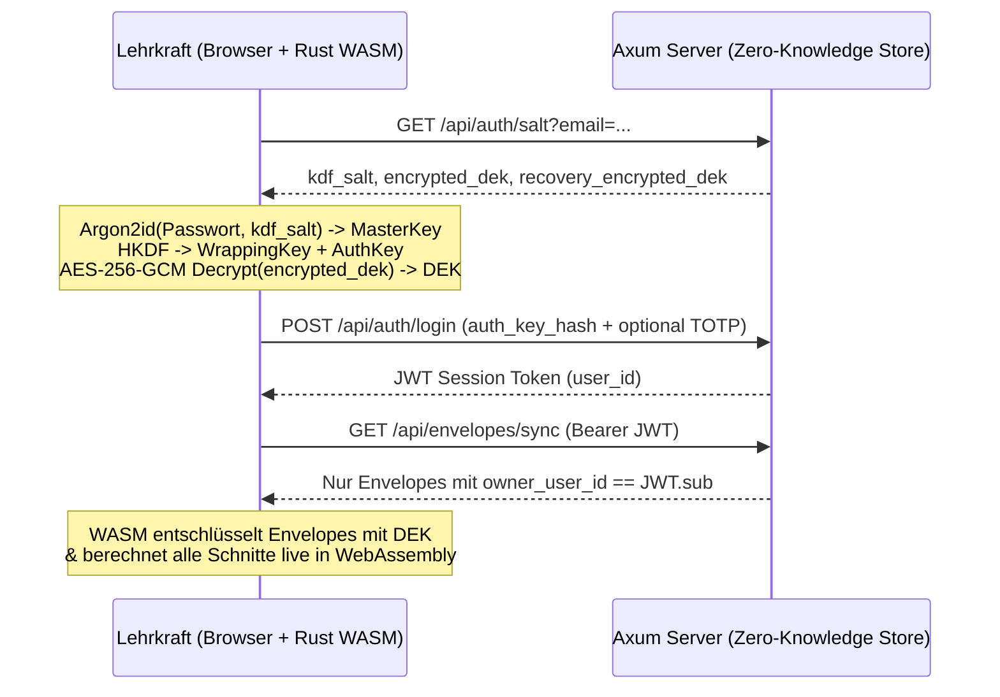

# Architektur- & Review-Handbuch (`v0.1.0-alpha`)

Dieses Dokument richtet sich an Entwicklerinnen, Entwickler, Datenschutzbeauftragte und Fachlehrkräfte, die die Alpha-Version `0.1.0` von **BTE NotenFlow** begutachten, testen und für zukünftige Releases weiterentwickeln.

---

## 1. Systemüberblick & Sicherheitsversprechen

BTE NotenFlow trennt strikt zwischen:
1. **Klartext-Domänenlogik im Browser (`crates/notenflow-core` als WebAssembly + `web/`)**:
   - Alle Namen, Einzelnoten, Bemerkungen, Gewichtungen und Niveaustufen (`G`/`M`/`E`) existieren im Klartext **ausschließlich im Arbeitsspeicher des Browsers**.
2. **Blinder Synchronisations- & Authentifizierungs-Server (`crates/notenflow-server`)**:
   - Speichert pro Lehrkraft (`owner_user_id`) lediglich kryptografische Metadaten (`kdf_salt`, `encrypted_dek`, `recovery_encrypted_dek`, Passkey-/TOTP-Daten) sowie undurchsichtige `AES-256-GCM`-Envelopes (`encrypted_payload`).

---

## 2. Kryptografische Spezifikation (`crates/notenflow-core/src/crypto.rs`)

| Komponente | Verfahren / Parameter | Zweck |
| :--- | :--- | :--- |
| **Passwort-KDF** | `Argon2id` (`m = 65536 KiB`, `t = 3`, `p = 4`, Output `32 Byte`) | Schutz gegen GPU-/ASIC-Cracking bei Kompromittierung der Server-Datenbank |
| **Key Separation** | `HKDF-SHA256` mit Domänen-Labels `notenflow-e2ee-kek-v1` & `notenflow-auth-hash-v1` | Trennt den lokalen *Key Encryption Key (KEK)* strikt vom Server-Login-Hash |
| **Payload-Chiffre** | `AES-256-GCM` (`96-Bit` Zufalls-Nonce pro Schreibvorgang) | Authentifizierte Verschlüsselung (Confidentiality + Integrity) |
| **Context Binding (AAD)** | `AAD = "{owner_user_id}:{entity_id}"` | Verhindert das Vertauschen von Chiffretexten zwischen Nutzern oder Datensätzen |
| **Notfall-Schlüssel** | `24-stelliger Base32-Code` -> `SHA-256` -> `AES-256-GCM` Wrapping des `DEK` | Erlaubt Passwort-Reset ohne Verlust des `DEK` (`wasm_wrap_dek_with_recovery` / `wasm_recover_dek`) |

---

## 3. Pädagogische Berechnungs-Engine (`crates/notenflow-core/src/grading.rs`)

### 3.1 Proportionale Kategorien-Skalierung (`scale_empty_categories`)
In vielen Klassen existieren zu Schuljahresbeginn z. B. bereits Vokabeltests (*Kategorie Tests: 20%*), aber noch keine Klassenarbeit (*Kategorie LNW: 50%*) und noch keine mündliche Note (*30%*).
- Ist `scale_empty_categories = true` (Standard), werden nur Kategorien mit mindestens einer bewerteten Leistung herangezogen und deren Gewichte proportional auf `100 %` normiert.
- Fehlt ein Schüler entschuldigt (`status = "excused"` / Eingabe `K`), wird diese Prüfung für dieses Kind neutral übersprungen, ohne den Teiler zu verfälschen.

### 3.2 Streichnoten (`drop_lowest_count`)
- Jede Kategorie kann `drop_lowest_count` (`0`, `1` oder `2`) definieren.
- Wichtig: Es wird immer mindestens **eine** Note pro Kategorie behalten (`let drop = cat.drop_lowest_count.min(scores.len().saturating_sub(1))`), damit eine Kategorie mit nur einer geschriebenen Arbeit niemals leerläuft.

### 3.3 Notenschlüssel & Binnendifferenzierung (`G` / `M` / `E`)
Die Umrechnung von Prozent (`0.0..=100.0`) in eine Note erfolgt in `percent_to_grade`:
1. Zunächst wird geprüft, ob für die Klasse `enable_student_levels = true` aktiviert ist.
2. Falls ja, wird der konfigurierte Prozent-Offset der Niveaustufe (`level_threshold_offsets`, z. B. `G: -5.0`, `M: 0.0`, `E: +3.0`) angewendet:
   $$\text{adjusted\_percent} = \text{clamp}(\text{percent} - \text{offset}, 0, 100)$$
   - Ein **negativer Offset** (z. B. `-5 %` auf `G`-Niveau) bedeutet: Die benötigte Prozenthürde sinkt um 5 Prozentpunkte (wer `70 %` erreicht, wird auf `70 - (-5) = 75 %` angehoben und erreicht bei einer 75%-Schwelle bereits die **Note 2**).
   - Ein **positiver Offset** (z. B. `+3 %` auf `E`-Niveau) bedeutet: Die benötigte Prozenthürde steigt um 3 Prozentpunkte (für eine **Note 2** sind `78 %` statt `75 %` erforderlich).

---

## 4. Checkliste für das Alpha-Review (`v0.1.0` -> `v0.2.0`)

Für das Code- und Fach-Review dieser Alpha-Version empfehlen wir insbesondere folgende Prüfpunkte:

### A. Fachlich-Pädagogisches Review
- [ ] **Rundungsregeln je Bundesland / Schulordnung**: Soll der Kategorie-Durchschnitt vor der Gesamtgewichtung auf eine Nachkommastelle gerundet oder exakt (IEEE-754 `f64`) weitergerechnet werden? (Aktuell: exakte Weiterberechnung, Rundung bei der Anzeige auf `0.1 %` bzw. `0.01` Notenwert).
- [ ] **Binnendifferenzierung (`G`/`M`/`E`)**: Sollen neben einer linearen Prozent-Verschiebung (`level_threshold_offsets`) künftig auch komplett getrennte Notenschlüssel-Tabellen pro Niveau hinterlegt werden können?
- [ ] **Halbjahres-Verrechnung (`Gesamtjahr`)**: Sollen im Modus `Gesamtjahr (all)` das 1. und 2. Halbjahr je `50:50` gewichtet werden oder alle Leistungsnachweise des gesamten Schuljahres gemeinsam in ihre Kategorien fließen? (Aktuell: gemeinsame Kategorien-Verrechnung über alle Assessments).

### B. Security- & Backend-Review
- [ ] **PostgreSQL-Persistenz im Produktivbetrieb**: Im lokalen Entwicklungsmodus nutzt `notenflow-server` eine JSON-Datei (`./data/vault_store.json`). Für Multi-Instanz-Deployments sollte die enthaltene SQL-Migration (`migrations/001_initial_schema.sql`) gegen PostgreSQL aktiviert werden.
- [ ] **WebAuthn / Passkey Kryptografie-Prüfung**: In `v0.1.0-alpha` validiert der Server die Passkey-Credential-ID und Challenge-Struktur. Vor `v1.0` sollte `webauthn-rs` für die vollständige Signaturprüfung des Authenticator-Attestation-/Assertion-Objekts integriert werden.
- [ ] **Passkey PRF Extension**: Aktuell speichert der Browser für den schnellen Passkey-Unlock den `DEK` nach einmaliger Freischaltung im lokalen Gerätespeicher. Zukünftig kann die WebAuthn `prf`-Erweiterung genutzt werden, um den `DEK` direkt durch das Hardware-Security-Modul des Passkeys zu entschlüsseln.
- [ ] **JWT Secret & Rate Limiting**: Vor öffentlichem Hosting muss `JWT_SECRET` zwingend über Umgebungsvariablen gesetzt und ein IP-/Account-basiertes Rate-Limiting auf `/api/auth/*` ergänzt werden.
